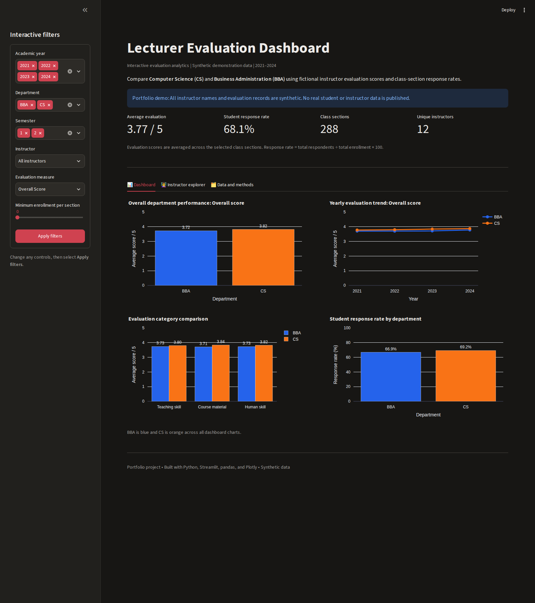
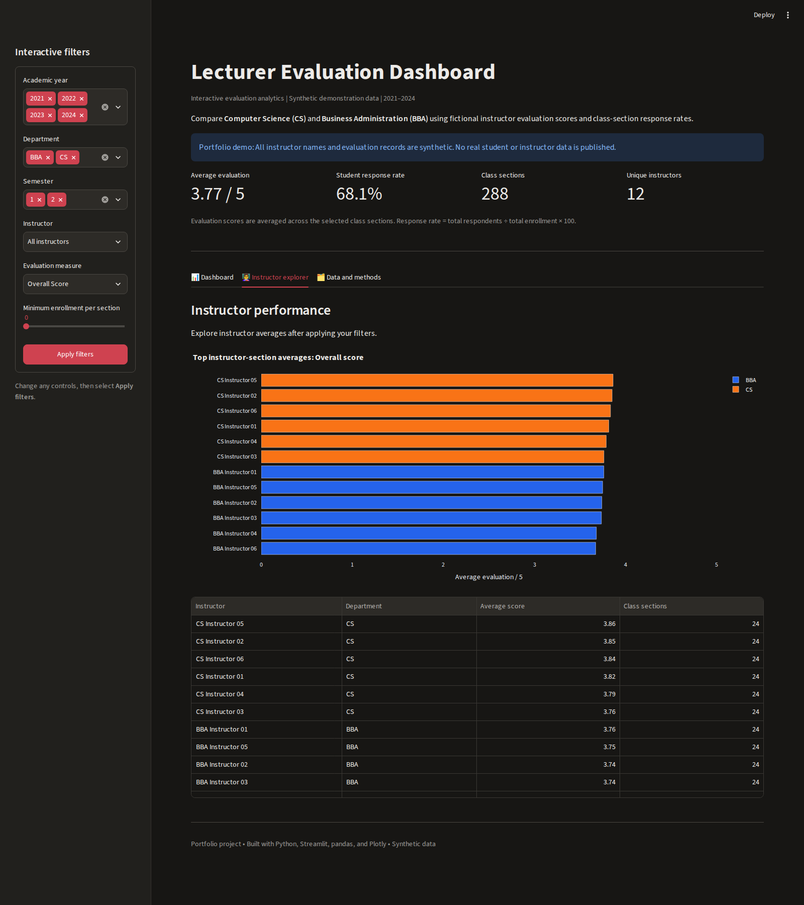

# Instructor Evaluation Dashboard

An interactive dashboard built with **Python, Streamlit, pandas, and Plotly** to explore fictional instructor evaluation scores, academic trends, and student participation across two departments.

> **Data privacy:** This public portfolio version uses **fully synthetic demonstration data**. All instructor labels, scores, subjects, and enrollment figures are fictional and do not represent real individuals or university results.

## Live demo

**[Launch the interactive Instructor Evaluation Dashboard](https://joseph-instructor-dashboard.streamlit.app/)**

This hosted application uses **synthetic demonstration data** and includes filters for academic year, department, semester, instructor, evaluation measure, and minimum enrollment.

## Features

- **Interactive filters:** Academic year, department, semester, instructor, evaluation measure, and minimum class enrollment.
- **Four visualizations:** Department performance, yearly score trends, evaluation category comparison, and student response rates.
- **Summary metrics:** Average evaluation, student response rate, number of class sections, and number of instructors.
- **Instructor Explorer:** Compare instructor averages across selected records.
- **Data & Methods:** View filtered records, download a filtered CSV, and review calculation definitions.

## Technology

Python · Streamlit · pandas · Plotly

## Run locally

1. Download/clone the repository.
2. Open a terminal in the project folder.
3. Run:

```bash
python3 -m venv .venv
source .venv/bin/activate
python -m pip install -r requirements.txt
python -m streamlit run app.py
```

Streamlit normally opens at `http://localhost:8501`. On Windows, activate the virtual environment with `.venv\Scripts\activate` instead.

## Project files

```text
instructor-evaluation-dashboard/
├── app.py
├── sample_instructor_evaluations.csv
├── requirements.txt
├── .gitignore
└── README.md
```

## How the metrics are calculated

- **Overall score:** Mean of teaching skill, material, and human skill evaluation scores for each class section.
- **Group comparison:** Arithmetic mean of the selected section scores.
- **Student response rate:** Total number of respondents ÷ total enrollment × 100, ensuring the rate is properly weighted by enrollment.

## Project background

Adapted from a university data visualization coursework project to demonstrate interactive analytics with Streamlit. The public version replaces the original class-provided dataset with fictional example records for privacy.

**AI assistance disclosure:** ChatGPT assisted with application implementation, testing guidance, documentation, and portfolio preparation.

## Screenshots

These screenshots were generated automatically from the **synthetic public demo**, not the coursework dataset.

### Dashboard



### Instructor Explorer



